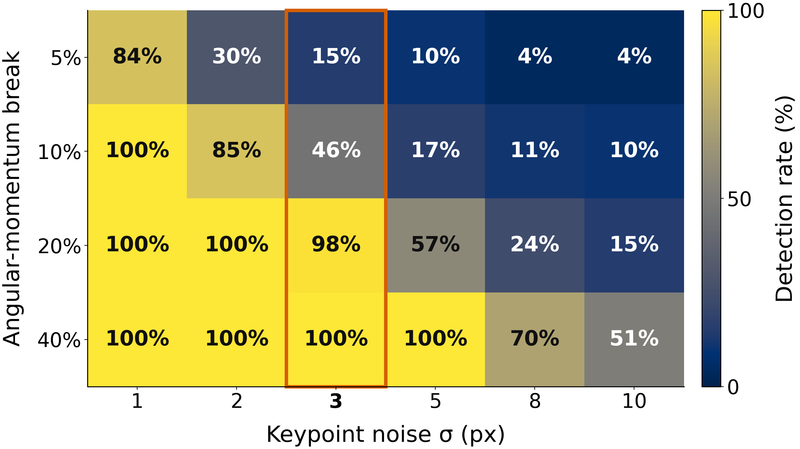
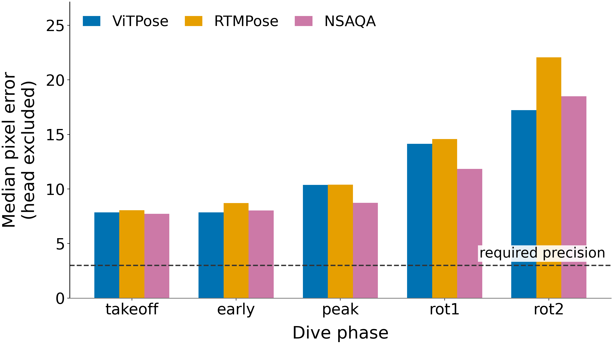
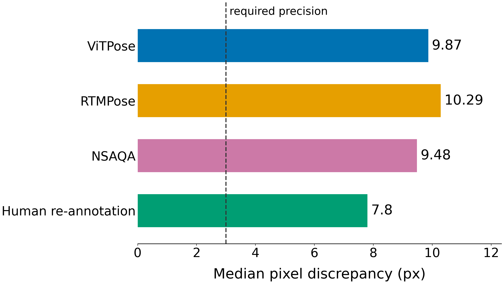
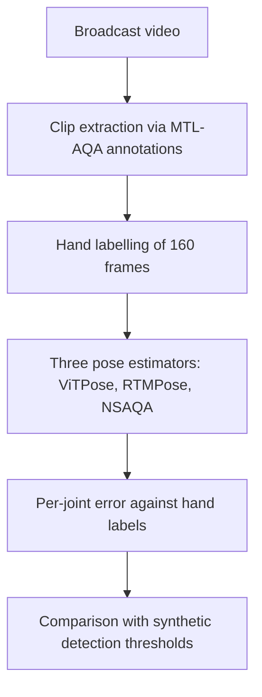

# Physics residuals for diving: a pose-precision limit

**How precise must monocular pose estimation be before flight-phase physics can assess a dive, and is it precise enough?**

**Required:** about **3 px** synthetic coordinate noise for reliable detection of larger angular-momentum breaks.  
**Achieved:** head-excluded median errors of **9.87 / 10.29 / 9.48 px** for ViTPose / RTMPose / NSAQA—insufficient evidence to pass this precision gate.  
**Where it fails:** error is greatest during **rotation**, where the proposed angular-momentum diagnostic is needed.

This is a negative feasibility result for raw single-frame broadcast pose, not a demonstrated method for scoring execution quality. The evidence covers **81 labellable frames**; the synthetic and measured error metrics differ, temporal filtering is untested, and human self-consistency does not establish a hard accuracy ceiling.

## The physics

During unpowered flight, neglecting air forces and external torque, the centre of mass follows a ballistic path and angular momentum about it is conserved:

$$
y_{\mathrm{COM}}(t)=y_0+v_0t-\frac{1}{2}gt^2
$$

$$
\boldsymbol{\tau}_{\mathrm{ext,COM}}=\mathbf{0}
\quad\Longrightarrow\quad
\frac{d\mathbf{L}_{\mathrm{COM}}}{dt}=\mathbf{0}.
$$

These are exact laws under the stated assumptions and provide label-free constraints that can be estimated from pose; monocular projected centre-of-mass and inertia calculations are approximations, not exact measurements of the physical quantities.

Under those assumptions, a violation implicates the pose/camera/measurement model rather than an athlete breaking a physical law; it does not by itself identify the pose estimator as the sole cause.

## Evidence



**Figure 1 — Requirement:** synthetic known-frame detection remains reliable at 3 px for larger breaks, but the heatmap does not establish reliable detection of small breaks or performance when searching an entire sequence.



**Figure 2 — Reality:** measured error rises during rotation for all estimators; these single-frame errors do not measure the accuracy of temporally filtered trajectories.



**Figure 3 — Limit:** model discrepancies are of similar magnitude to human self-disagreement, consistent with image ambiguity, but this comparison does not establish a hard imagery ceiling or human-equivalent accuracy.

## Pipeline



## Results

| Method / requirement | Median error (px) | p90 error (px) | Gross failures (%) |
|---|---:|---:|---:|
| Synthetic precision reference | 3 | — | — |
| ViTPose | 9.87 | 78.97 | 14.23 |
| RTMPose | 10.29 | 69.91 | 12.13 |
| NSAQA, diving-finetuned | 9.48 | 33.99 | 8.37 |

Model rows pool head-excluded observations from `takeoff`, `early`, `peak`, `rot1`, and `rot2`: **440 measured errors from 478 visible joint labels per model**. Medians are computed from joint errors, not from phase medians. A placed joint farther than half a hand-labelled torso is a gross failure; the rate uses all visible joint labels as denominator. Missing predictions are counted separately, omitted from error quantiles, and not counted as placed-joint gross failures. Finite gross errors remain in the quantiles.

Domain finetuning improves the error tail and gross-failure rate much more than the median. The synthetic reference is **per-coordinate Gaussian noise**, whereas model errors are **Euclidean distances**: the comparison is indicative, not an identical-metric pass/fail test.

Sources: [computed table](results/readme_results.csv), [frame counts](results/readme_counts.csv), [thresholds](results/detection_threshold.csv), and [per-phase medians](results/figures/figure_2_phase_medians.csv).

## What this does not show

- Human self-disagreement (**7.8 px**, **47 paired points across 6 frames**) is not model-versus-label error; the sample is small, and its supplied overall median is not specified as head-excluded. See [human consistency](results/human_consistency.csv).
- Errors are single-frame, without temporal filtering. Filtering might cross the precision threshold, or suppress the physical residual signal being sought; neither outcome was tested here.
- **81 frames** were analysed from **160 labelled PNGs**, requiring a labelled shoulder and hip; **0 of 20 entry frames** had a labellable torso, so entry is unmeasurable in this analysis, not shown to have low error.
- Head is excluded: the hand-labelled head, COCO nose and MPII head top have different definitions.
- Projection, camera motion, segment-mass approximations and out-of-plane motion limit physical interpretation. A free-gravity quadratic fit can absorb non-ballistic motion; a small ballistic residual is not proof of valid physics.
- These experiments do not show that residuals predict judges' scores or localize execution faults.

## Reproduce it

Regenerate the published tables and figures from the committed CSVs, from a shell:

```bash
git clone https://github.com/donti507/physics-residual-aqa.git
cd physics-residual-aqa
python -m venv .venv
. .venv/bin/activate
python -m pip install numpy matplotlib
python src/summarize_results.py
python src/make_figures.py --results results
```

Outputs are `results/readme_results.csv`, `results/readme_counts.csv` and the PNGs and plotted-data CSVs in `results/figures/`.

To recreate source frames separately, first obtain the videos listed in `src/cut_clips.py`, place them at the repository root, install FFmpeg, and place the authors' annotations at `Ready_2_Use/MTL-AQA_split_0_data/final_annotations_dict.pkl`; then run, in order:

```bash
python src/cut_clips.py
python src/extract_label_frames.py
```

Frame extraction rewrites `label_frames_index.csv`; use a separate checkout to preserve the published index. Hand labels are in `data/labels/`.

**Reproducibility limit:** this checkout does not yet contain the pose-comparison or synthetic-trial generation scripts, model checkpoints, or source videos. The commands above reproduce the published tables/plots and frame-extraction stages, not the entire experiment. No command for an absent script is implied.

## Data and licensing

- **MTL-AQA:** Parmar & Morris, *What and How Well You Performed? A Multitask Learning Approach to Action Quality Assessment*, CVPR 2019 ([paper](https://openaccess.thecvf.com/content_CVPR_2019/html/Parmar_What_and_How_Well_You_Performed_A_Multitask_Learning_Approach_CVPR_2019_paper.html), [authors' repository](https://github.com/ParitoshParmar/MTL-AQA)). Videos were downloaded from the authors' YouTube links and are **not redistributed** here.
- **NSAQA weights:** Okamoto & Parmar, *Hierarchical NeuroSymbolic Approach for Comprehensive and Explainable Action Quality Assessment*, CVPR 2024 CVSports ([paper](https://openaccess.thecvf.com/content/CVPR2024W/CVsports/html/Okamoto_Hierarchical_NeuroSymbolic_Approach_for_Comprehensive_and_Explainable_Action_Quality_Assessment_CVPRW_2024_paper.html), [authors' repository and terms](https://github.com/laurenok24/NSAQA)). The authors restrict their materials to **non-commercial use**; this repository's MIT licence does not override those terms.
- **This repository's code:** [MIT](LICENSE). **Hand labels are released here** in [data/labels/](data/labels/), without source imagery.
